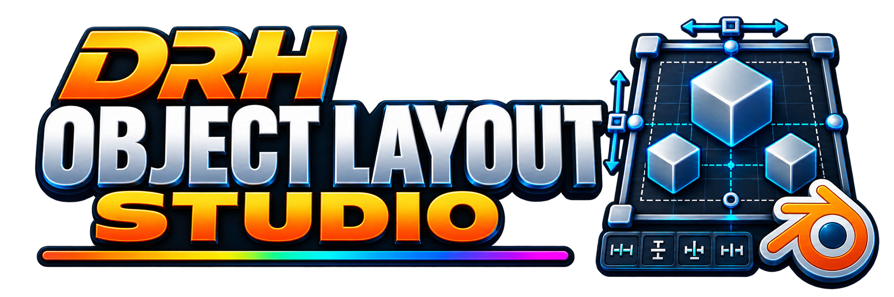
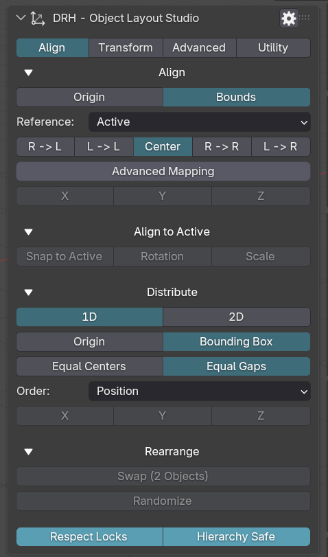
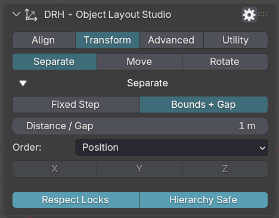

# DRH - Object Layout Studio

**Align to the geometry you actually see, not the origin point that lied to you.**

  

  

## The wall

Blender aligns to origins. Your model has a bevel, a solidify, and a mirror on it, so the origin sits nowhere near the visible edge. You align two chairs to the left, look at the viewport, and one of them is floating 4 cm off the wall.

Object Layout Studio aligns against evaluated bounds: the shape after modifiers do their work. That single difference removes most of the nudge, eyeball, nudge again loop.

## Two builds, one panel

**Complete** is the full workflow: align, distribute, arrange, orient, register, ground, quantize, and transform, with geometry-aware handling for objects whose real bounds don't match their origin.

**Lite** is the same alignment core without the geometry-aware extras. Align, space, rotate, match transforms. Smaller surface, fewer decisions.

## References you can align against

Origin, evaluated bounds, the active object, the selection, the 3D cursor, or world space. Each reference maps through minimum, center, or maximum, so "align left" means the left edge of the thing you see.

## Who it's for

Scene assembly where objects were modeled by someone else. Interior and product layouts measured against walls and shelves. Kitbashing sessions where 60 pieces need to sit at consistent heights.

## Get it

Free on BlendKit, Blender 4.2 or newer.

| Build | Download |
|---|---|
| Object Layout Studio Complete 1.0.0 | [BlendKit](https://www.blendkit.com/asset-gallery-detail/63177030-cdb4-45ae-8bec-76a3ee48d151/) |
| Object Layout Studio Lite 1.0.0 | [BlendKit](https://www.blendkit.com/asset-gallery-detail/0b1494ca-c801-4cbf-9783-46ddbcf0090f/) |

Changelog: [CHANGELOG.md](CHANGELOG.md) · Bugs and requests: [open an issue](https://github.com/pacosalasv/DRH_Object_Layout_Studio-Support/issues)

  

